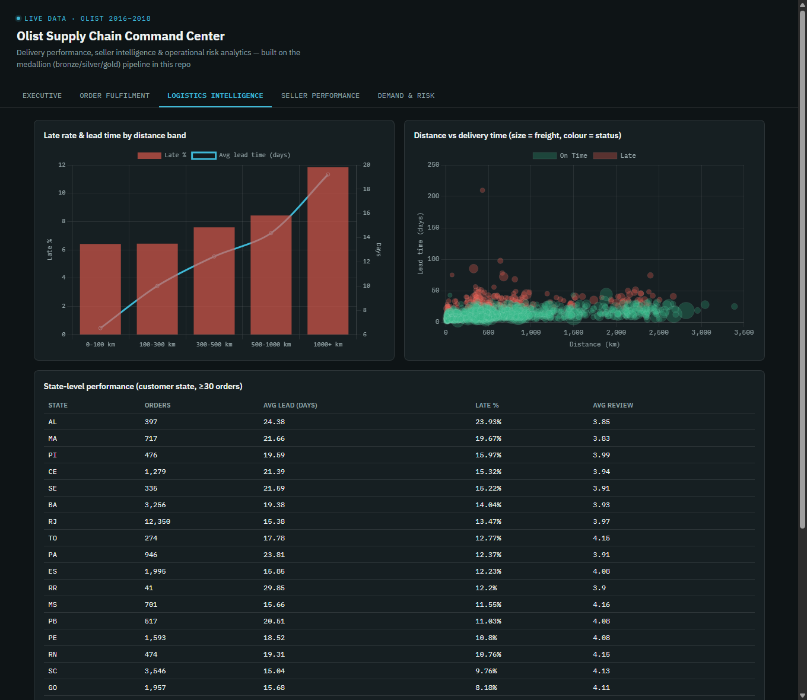
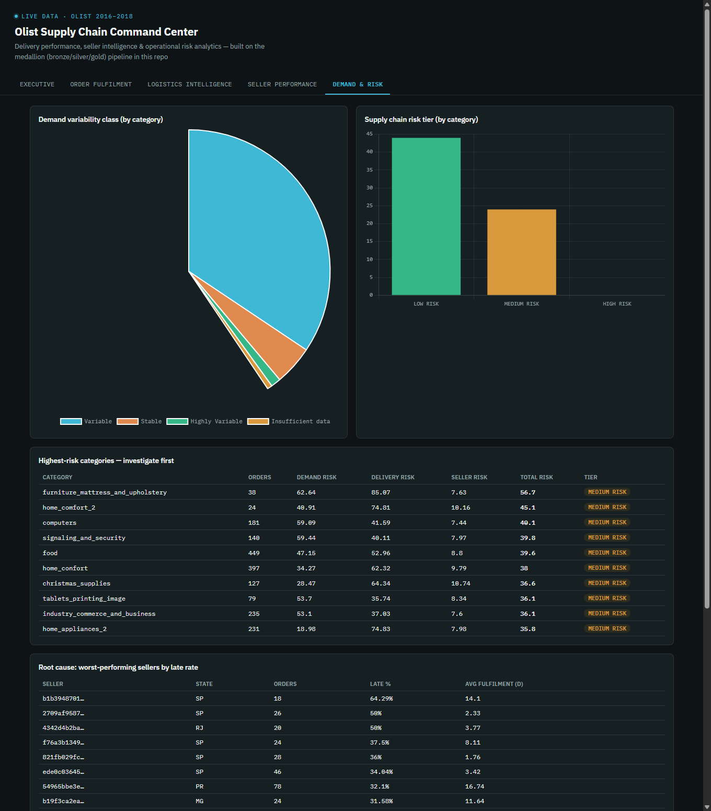

# Olist Supply Chain Command Center

**E-Commerce Supply Chain Command Center: Delivery Performance, Seller Intelligence & Operational Risk Analytics**


A medallion-architecture analytics pipeline built on the [Olist Brazilian E-Commerce dataset](https://www.kaggle.com/datasets/olistbr/brazilian-ecommerce) (~99k real, anonymised orders, 2016–2018). This is **not a sales dashboard** — it's an investigation into why orders are delayed, which sellers/products/regions carry the most operational risk, and what the business should do about it.

<p align="center">
  
</p>

## Contents

- [Business questions](#business-questions)
- [Architecture](#architecture)
- [Star schema](#star-schema-gold-layer)
- [Repository layout](#repository-layout)
- [Running it](#running-it)
- [Phase 1 — Data quality](#phase-1--data-quality)
- [Key findings](#key-findings)
- [Order size statistics](#order-size-statistics-items-per-order)
- [Dashboard](#dashboard)
- [Known limitations](#known-limitations)
- [License](#license)

## Business questions

1. Where in the fulfilment process are delays occurring?
2. Which sellers create the greatest operational risk?
3. Does geographical distance explain delivery delays and freight costs?
4. Which products/categories have unstable demand?
5. Do multi-seller orders increase delivery complexity?
6. Which regions have the worst customer experience?
7. Which seller-product combinations should management investigate first?

## Architecture

```
   OLIST RAW CSVs (9 files)
            │
            ▼
    ┌───────────────┐
    │  BRONZE LAYER │   raw, untyped, 1:1 with source CSVs
    └───────┬───────┘
            │  data quality audit (sql/bronze/02_data_quality_checks.sql)
            ▼
    ┌───────────────┐
    │  SILVER LAYER │   typed, deduplicated, DQ-flagged
    └───────┬───────┘
            │  feature engineering
            ▼
    ┌───────────────┐
    │   GOLD LAYER  │   star schema: dims + fact_order_item + fact_delivery
    └───────┬───────┘
            │
   ┌────────┼─────────────┐
   ▼        ▼              ▼
 SQL KPIs  Python Stats   Risk Model
   └────────┼─────────────┘
            ▼
   dashboard/index.html  (static HTML "executive dashboard")
```

Stack: **Python → PostgreSQL → SQL transformations → static HTML dashboard**. This is the "build locally first" fallback of the classic recommended stack for this kind of project — AWS/QuickSight require cloud infrastructure that isn't part of this repo's scope, so the same medallion architecture and star schema are implemented against local PostgreSQL, with a self-contained HTML/Chart.js dashboard standing in for QuickSight. Every SQL/Python artifact here would port to Athena + QuickSight largely unchanged — the `gold` schema tables map directly to Athena tables over S3 Parquet.

## Star schema (gold layer)

```
                    dim_customer
                         │
dim_date ──────── fact_order_item ─────── dim_product
                         │
                         ▼
                    dim_seller ──────── dim_geography
                         │
                         ▼
                  fact_delivery
```

**Grain of `fact_order_item` = one product item within one order** (not order-level), so a seller's operational problems inside a multi-seller order stay visible instead of being averaged away. `fact_delivery` is order-grain, since Olist captures delivery timestamps once per order, not once per shipment/seller.

## Repository layout

```
sql/bronze/   raw staging schema + the data-quality audit queries
sql/silver/   cleaning/typing/dedup transformations (bronze -> silver)
sql/gold/     star schema build (dims, fact_order_item, fact_delivery)
sql/kpis/     the "SQL KPIs" arm — dashboard-ready queries per business area
python/       loaders, the DQ report, and every analysis phase (see below)
reports/      generated markdown reports + charts (committed, not gitignored)
data/exports/ generated CSVs consumed by the dashboard and reports
dashboard/    the static HTML executive dashboard (index.html + data.js)
docs/         README screenshots
```

## Running it

Requires PostgreSQL running locally and the raw Olist CSVs downloaded from Kaggle (not committed to this repo — large + third-party licensed). Point `OLIST_RAW_DIR` at wherever you extracted them (defaults to `python/config.py`'s hardcoded path).

```bash
pip install -r requirements.txt
cd python
python run_pipeline.py    # runs every stage, in order, end to end
```

Or run any stage standalone once bronze/silver/gold exist, e.g. `python risk_index.py` after changing the risk weights. Then open `dashboard/index.html` in a browser (needs internet for the Google Fonts / Chart.js CDN imports).

## Phase 1 — Data quality

Full report: [`reports/data_quality_report.md`](reports/data_quality_report.md). The bronze-layer audit found real issues that directly shaped the silver-layer cleaning rules — nothing was silently fixed; every issue is carried through to gold as an explicit boolean flag.

| Check | Finding | Silver-layer handling |
|---|---|---|
| Products missing category | 610 of 32,951 | Coalesced to `'unknown'` |
| Carrier handover before payment approved | 1,359 orders | Flagged `is_carrier_before_approved`, excluded from lead-time analysis |
| Delivered before carrier handover | 23 orders | Flagged `is_delivered_before_carrier`, excluded |
| `delivered` status with no delivered timestamp | 8 orders | Flagged `is_missing_delivered_date_bug`, excluded |
| Duplicate reviews | 814 duplicate `review_id`s / 551 orders with >1 review | Deduplicated to the latest-answered review per order |
| Customer/seller zip prefixes with no geolocation sample | 157 / 7 | Falls back to state-level lat/lon centroid in `dim_geography` |
| Orders with zero order_items | 775 (603 `unavailable`, 164 `canceled`, rest early-lifecycle) | Out of scope for `fact_delivery` by design — nothing to compute a lead time from |

## Key findings

**Lead-time decomposition** (avg days, delivered orders): Payment **0.40d** → Seller Fulfilment **2.85d** → Transit **9.36d** → Total **~12.6d**. Transit is the dominant stage, and the gap widens sharply for late orders — they spend **3.2x** longer in transit and **2.0x** longer in seller fulfilment than on-time orders. Transportation is the primary lever; seller fulfilment is secondary.

**On-time delivery**: 91.89% overall. The worst-performing customer states are in the North/Northeast (AL 23.9% late, MA 19.7% late) versus SP at 5.9% late — largely a distance story, since SP hosts most sellers.

**Distance genuinely predicts delay** (Pearson r = 0.39 vs. lead time, r = 0.32 vs. freight cost, r = −0.06 vs. review score — distance alone barely moves satisfaction). Late rate climbs monotonically from 6.4% (0–100km) to 11.8% (1000km+).

**Seller Performance Score** (30% OTD + 25% fulfilment speed + 20% cancellation rate + 15% review score + 10% freight efficiency, min-max normalised 0–100): of 1,794 sellers with ≥5 orders — 1,070 Excellent, 661 Good, 48 At Risk, **15 Critical**. Full ranked list: [`data/exports/seller_scorecard.csv`](data/exports/seller_scorecard.csv).

**Demand variability**: 61 of 72 categories are "Variable" (CV 0.5–1.0); 188 category-weeks flagged as demand anomalies (|Z| > 2).

**Supply Chain Risk Index** (40% demand + 35% delivery + 25% revenue-weighted seller risk): 44 categories Low Risk, 24 Medium Risk, 0 High Risk — risk here is *relative* across categories, not absolute, so no single category is simultaneously worst on all three dimensions at once. `furniture_mattress_and_upholstery` tops the list (56.7), driven by a very high delivery-risk component (85.1).

**Root cause / multi-seller hypothesis — rejected, with a twist.** Orders spanning 2+ sellers are *not* more delay-prone — they're actually late less often (0.7% vs. 8.2% for single-seller orders) and arrive faster, most likely a selection effect since multi-seller orders skew toward higher-volume, more reliable sellers and are rare (<1.5% of orders). But **customer satisfaction runs the opposite direction**: average review score drops sharply as seller count rises (4.17 → 2.89 → 2.24). Multi-seller orders are operationally faster and more reliable by the clock, yet customers rate them worse — Olist's schema has no per-shipment timestamp to confirm it, but split/partial deliveries are the leading theory. Flagged as an open question in [`reports/root_cause_analysis.md`](reports/root_cause_analysis.md) rather than forced to a tidy conclusion.

## Order size statistics (items per order)

This dataset's analogue of a "units per carton" metric: an order is the bundling/shipping unit, and how many product items get packed into it matters for pick-pack and packaging planning the same way units-per-carton does in retail logistics. Full descriptive statistics — mean, revenue-weighted average, p25/median/p75, harmonic mean, std dev, min, max — computed overall and broken down by distance band, region, and seller complexity: [`reports/order_size_stats.md`](reports/order_size_stats.md).

|  | n_orders | mean | weighted avg (by revenue) | p25 | median | p75 | harmonic mean | std dev | min | max |
|---|---:|---:|---:|---:|---:|---:|---:|---:|---:|---:|
| **All orders** | 98,199 | 1.14 | 1.27 | 1 | 1 | 1 | 1.06 | 0.54 | 1 | 21 |

The median order is a single item — most Olist orders are one-item transactions — but the revenue-weighted average (1.27) sitting above the plain mean (1.14) shows higher-value orders skew toward slightly larger baskets. The real signal is in the seller-complexity breakdown: orders touching 2 sellers average 2.36 items, and 3+ sellers average 3.85 — mechanically expected (more sellers implies more items) but it confirms multi-seller orders are a distinct, larger-basket population, not random noise.

## Dashboard

Five tabs — Executive, Order Fulfilment, Logistics Intelligence, Seller Performance, Demand & Risk — built as a single static HTML file (`dashboard/index.html` + `dashboard/data.js`) so it needs no server.

<p align="center">
  <br>
  <sub>Logistics Intelligence — late rate by distance band, the distance/lead-time/freight/OTD scatter, and state-level performance</sub>
</p>

<p align="center">
  <br>
  <sub>Demand & Risk — variability classification, Supply Chain Risk Index, and the root-cause drill-down</sub>
</p>

## Known limitations

- Fulfilment time and review score are captured at **order** grain in the source data (Olist doesn't timestamp shipments per seller), so in a multi-seller order every seller inherits the same order-level values — a real constraint on how precisely seller-level fulfilment speed can be attributed.
- The Supply Chain Risk Index is a relative ranking across categories in *this* dataset, not a calibrated absolute risk probability.
- Geolocation is aggregated to zip-prefix centroids (Olist ships 5-digit-prefix precision only), so Haversine distances are approximate, not door-to-door.

## License

Code in this repository is released under the [MIT License](LICENSE). The underlying dataset is Olist's [Brazilian E-Commerce Public Dataset](https://www.kaggle.com/datasets/olistbr/brazilian-ecommerce), distributed by Olist under its own Kaggle license terms — it is not redistributed in this repo and must be downloaded separately.
