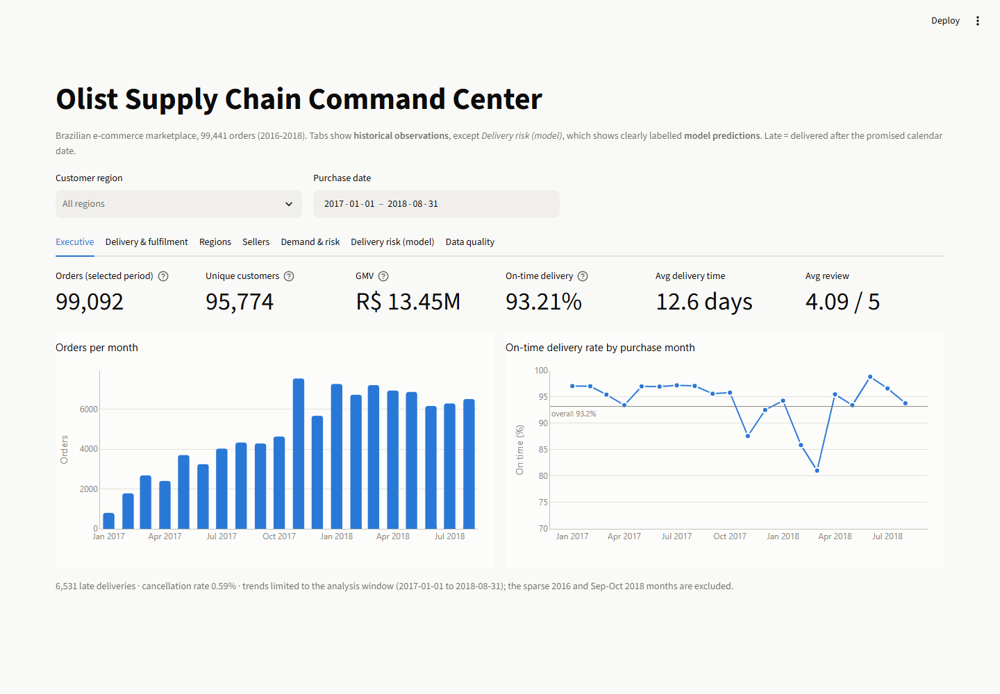
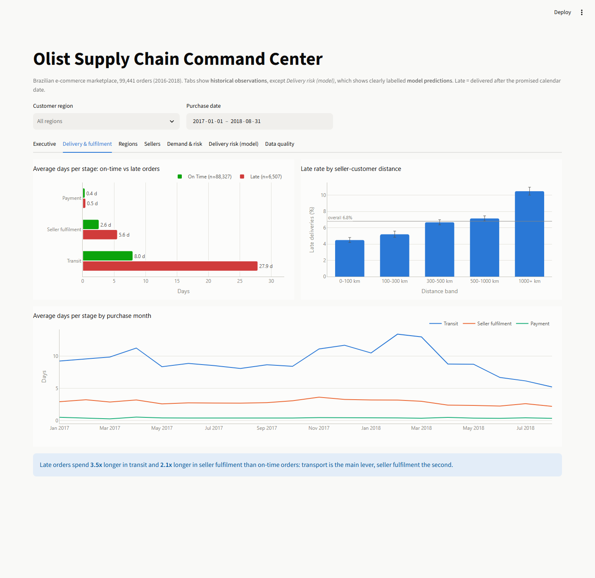
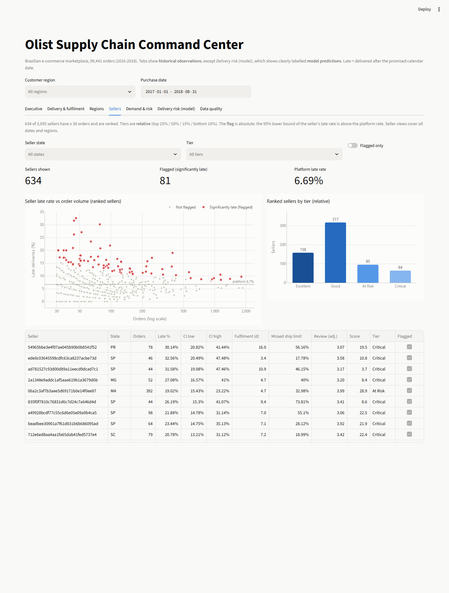

# Olist Supply Chain Command Center

**E-Commerce Supply Chain Command Center: Delivery Performance, Seller Intelligence & Operational Risk Analytics**


A medallion-architecture analytics pipeline built on the [Olist Brazilian E-Commerce dataset](https://www.kaggle.com/datasets/olistbr/brazilian-ecommerce) (99,441 real, anonymised orders, 2016–2018). This is **not a sales dashboard** — it's an investigation into why orders are delayed, which sellers/products/regions carry the most operational risk, and what the business should do about it.

<p align="center">
  
</p>

## Contents

- [What changed in v2, and why](#what-changed-in-v2-and-why)
- [Business questions](#business-questions)
- [Architecture](#architecture)
- [Star schema](#star-schema-gold-layer)
- [Repository layout](#repository-layout)
- [Running it](#running-it)
- [Testing](#testing)
- [Phase 1 — Data quality](#phase-1--data-quality)
- [Key findings](#key-findings)
- [Delivery-delay prediction](#delivery-delay-prediction)
- [Order size statistics](#order-size-statistics-items-per-order)
- [Dashboard](#dashboard)
- [Known limitations](#known-limitations)
- [License](#license)

## What changed in v2, and why

v1 ran on PostgreSQL with no automated tests. A review against the raw data found several metric definitions that produced wrong or misleading numbers. v2 moves the pipeline to DuckDB + Parquet, fixes those definitions, and pins each fix with a test. **Every figure in this README is from v2**; v1 figures are shown below only to document the corrections.

| # | Problem in v1 | Fix in v2 | Effect |
|---|---|---|---|
| 1 | On-time compared `delivered_ts <= estimated_ts`, but the estimate is always midnight, so orders delivered **on** their due date counted as late | Compare calendar dates | On-time **91.89% → 93.23%** (1,292 orders reclassified) |
| 2 | Multi-seller late rate was an unweighted average of the 2-seller (n=1,216) and 3+-seller (n=59) band rates | Order-weighted rate + significance test | **0.7% → 1.02%** (vs 6.85% single-seller, p≈2e-16) |
| 3 | Seller and category rates were averaged over **item** rows, so a 3-item order counted 3 times | New `fact_seller_order` grain; categories counted per order | Up to 38 points of change in an individual seller's on-time rate |
| 4 | Sellers ranked from 5 orders, min-max scored, fixed tier cut-offs | ≥30 orders to rank, empirical-Bayes shrinkage, percentile scoring, explicitly relative tiers, plus a significance-based late-rate flag | 1,794 → **634** ranked sellers; **81** flagged with statistical evidence |
| 5 | Demand CV and Z-scores ignored zero-sales weeks and included the near-empty 2016 / Sep–Oct 2018 edges | Complete category × week grid, full weeks inside a fixed analysis window | Sparse categories correctly show as volatile/intermittent |
| 6 | Revenue included cancelled orders; cancellation rate excluded the 775 orders with no items | `fact_order` holds all 99,441 orders; GMV excludes cancelled/unavailable | Cancellation rate uses the full denominator (0.63%) |
| 7 | Risk tiers used absolute cut-offs on min-max scores, producing "0 High Risk" as an artefact | Percentile components, relative tiers (top 20% / 40% / 40%) | Index is now clearly a ranking, not a probability |
| 8 | 13 products in categories missing from the translation file were relabelled `unknown` | Keep the Portuguese category name | No silent data loss |

## Business questions

1. Where in the fulfilment process are delays occurring?
2. Which sellers create the greatest operational risk?
3. Does geographical distance explain delivery delays and freight costs?
4. Which products/categories have unstable demand?
5. Do multi-seller orders increase delivery complexity?
6. Which regions have the worst customer experience?
7. Which seller-product combinations should management investigate first?

## Architecture

```
   OLIST RAW CSVs (9 files)
            │  SHA-256 per file: unchanged files are skipped (incremental)
            ▼
    ┌───────────────┐
    │  BRONZE LAYER │   Parquet, every column as text, + lineage columns
    └───────┬───────┘   (_source_file, _source_sha256, _ingested_at)
            │  data quality audit (sql/bronze/01_data_quality_checks.sql)
            ▼
    ┌───────────────┐
    │  SILVER LAYER │   typed, deduplicated, DQ-flagged          -> data/silver/*.parquet
    └───────┬───────┘
            ▼
    ┌───────────────┐
    │   GOLD LAYER  │   star schema (dims + 3 fact grains)       -> data/gold/*.parquet
    └───────┬───────┘
            │                      enforced by pytest data contracts
   ┌────────┼─────────────┐
   ▼        ▼              ▼
 SQL KPIs  Python Stats   Risk Model
   └────────┼─────────────┘
            ▼
   reports/*.md, data/exports/*.csv, dashboard/data.js
```

Stack: **Python → DuckDB (SQL) → Parquet → reports + dashboard**. DuckDB is an in-process analytical database: no server to run, which makes the pipeline reproducible in CI and Docker. At ~100k orders it rebuilds every layer and analysis end to end in **under 10 seconds** on a laptop. The gold Parquet files are the hand-off point for BI tools.

## Star schema (gold layer)

```
                       dim_customer
                            │
dim_date ──── fact_order_item ──── dim_product
                 │          │
                 │      dim_seller ──── dim_geography
                 ▼
         fact_seller_order  (order × seller)
                 │
                 ▼
            fact_order      (order, all 99,441)
```

| Fact table | Grain | Used for |
|---|---|---|
| `fact_order_item` | one product unit in one order | demand, revenue, distance |
| `fact_seller_order` | one seller in one order | every seller-level metric |
| `fact_order` | one order — **including** the 775 with no items | headline KPIs, delivery, lead times |

## Repository layout

```
src/ingestion/       bronze: CSV -> Parquet, incremental by file hash
src/quality/         bronze data-quality audit report
src/transformation/  silver and gold builders (run the SQL in sql/)
src/analytics/       scorecard, demand, logistics, risk, root cause, shared stats
src/models/          delivery-delay prediction (walk-forward backtest, SHAP)
src/dashboard/       Streamlit app (app.py, data.py, charts.py) + static export
src/pipeline.py      end-to-end runner with per-stage timings
sql/                 bronze audit, silver, gold, KPI and ML-feature queries (DuckDB SQL)
tests/               transformation, data-contract, analytics and dashboard tests
reports/             generated markdown reports + charts (committed)
data/exports/        generated CSVs consumed by the dashboard and reports (committed)
dashboard/           lightweight static HTML version (index.html + data.js)
```

## Running it

Download the dataset from Kaggle (not committed: large, third-party licensed) and point `OLIST_RAW_DIR` at the extracted folder (default `data/raw/`).

```bash
pip install -r requirements.txt
export OLIST_RAW_DIR=/path/to/olist        # PowerShell: $env:OLIST_RAW_DIR="C:\path\to\olist"
python -m src.pipeline                     # incremental bronze, rebuild everything else
python -m src.pipeline --force             # re-ingest all source files
streamlit run src/dashboard/app.py         # open the Command Center at http://localhost:8501
```

Each stage also runs on its own, e.g. `python -m src.analytics.risk_index` after changing the risk weights. Stage timings are written to `data/run_log.json`.

## Testing

```bash
python -m pytest
```

- **Transformation tests** build bronze → silver → gold from a small synthetic Olist dataset (`tests/conftest.py`). Each row exists to trigger one rule, including every v1 bug above. This runs in CI with no Kaggle download.
- **Data contracts** (`tests/test_data_quality.py`): primary-key uniqueness, row counts and money reconciling across layers and grains, orphan checks, status domains, non-negative lead times. They run on the synthetic warehouse, and on the real one when it has been built locally.
- **Analytics unit tests** cover the statistics (Wilson intervals, shrinkage, percentile scoring, tiering) and the demand classification.
- **Dashboard tests** run the Streamlit app headless (`streamlit.testing`): it explains missing pipeline outputs, renders all six tabs, and its filters change the figures without errors.

A mutation check confirms the suite works: putting the v1 timestamp comparison back fails two tests.

## Phase 1 — Data quality

Full report: [`reports/data_quality_report.md`](reports/data_quality_report.md). The bronze-layer audit found real issues that directly shaped the silver-layer cleaning rules. Nothing is silently fixed; every issue is carried through to gold as an explicit flag.

| Check | Finding | Silver/gold handling |
|---|---|---|
| Products missing category | 610 of 32,951 | `'unknown'` |
| Category missing from translation file | 13 products (`pc_gamer`, `portateis_cozinha_…`) | Keep the Portuguese name |
| Carrier handover before payment approved | 1,359 orders | Flagged `is_carrier_before_approved`, excluded from lead-time analysis |
| Delivered before carrier handover | 23 orders | Flagged `is_delivered_before_carrier`, excluded |
| `delivered` status with no delivered timestamp | 8 orders | Flagged `is_missing_delivered_date_bug`, excluded |
| Delivered on the estimated date, after midnight | 1,292 orders | Judged on calendar date → on time |
| Duplicate reviews | 814 duplicate `review_id`s / 551 orders with >1 review | Latest-answered review per order |
| Customer/seller zip prefixes with no geolocation sample | 157 / 7 | State-level centroid in `dim_geography` |
| Orders with zero order_items | 775 (603 `unavailable`, 164 `canceled`, 8 early-lifecycle) | Kept in `fact_order` (`has_items = false`) |
| Sparse edges of the date range | 2016 has a gap; Sep–Oct 2018 hold 20 orders | Trends use a 2017-01-01 → 2018-08-31 analysis window |

## Key findings

**Headline** (all 99,441 orders; 96,096 unique customers): GMV R$ 13.49M (excluding cancelled/unavailable), **on-time delivery 93.23%**, 6,534 late orders, cancellation rate 0.63%, average review 4.09 / 5.

**Lead-time decomposition** (avg days, 95,097 delivered orders with valid timestamps): Payment **0.40d** → Seller Fulfilment **2.85d** → Transit **9.36d** → Total **12.6d**. Late orders spend **3.5×** longer in transit and **2.1×** longer in seller fulfilment than on-time orders. Transportation is the primary lever; seller fulfilment is secondary.

**Regional gap**: the worst customer states are in the Northeast — AL 21.4% late, MA 17.4%, SE 15.2% — against SP at 4.5%. The single largest hotspot is 1000+ km deliveries into the Northeast: 8,434 orders at 13.2% late (95% CI 12.5–13.9%).

**Distance predicts delay**: Spearman ρ = 0.54 vs lead time and 0.58 vs freight cost (Pearson r = 0.39 / 0.32 — both are right-skewed, so the rank correlation is the better summary), but only ρ = −0.06 vs review score. The late rate rises steadily from 4.5% (0–100 km) to 10.4% (1000+ km).

**Seller Performance Score**: 634 sellers have ≥30 orders and are ranked; the other 2,461 are listed with their order counts but not ranked. Rates are shrunk toward the platform average before scoring, components are percentile-ranked, and tiers are relative (top 25% Excellent … bottom 10% Critical: 158 / 317 / 95 / 64). Separately, **81 sellers** have a late rate whose 95% lower bound is above the platform rate of 6.69%. That is evidence of a real problem rather than a ranking position, and it is where to start. Full list: [`reports/seller_scorecard.md`](reports/seller_scorecard.md).

**Demand variability** (86 full weeks, zero-sales weeks included): of 54 categories with enough volume, 34 are Variable, 17 Highly Variable and 3 Stable by CV. The Syntetos–Boylan inventory classification puts 28 as Smooth, 11 Erratic, 11 Lumpy and 4 Intermittent. Lumpy and intermittent categories need different stocking policies from smooth ones. 192 category-weeks are flagged as anomalies (|Z| > 2).

**Supply Chain Risk Index** (40% demand + 35% delivery + 25% revenue-weighted seller risk, 52 categories): a relative ranking, top 20% labelled High. The top three are `christmas_supplies` (83.7), `home_confort` (82.3) and `signaling_and_security` (80.8). For some categories, seller risk rests on a small share of scored revenue (shown as `scored_revenue_share`).

**Multi-seller hypothesis: rejected for delays, but reviews are worse.** Orders spanning 2+ sellers are 1.3% of delivered orders (n = 1,275) and are late *less* often: 1.02% vs 6.85% for single-seller orders (two-proportion z-test p ≈ 2e-16). Yet customers rate them much worse: 2.86 vs 4.17 (Mann–Whitney p ≈ 6e-188), falling to 2.24 for 3+ sellers. This is an association, not a cause: these orders differ in basket size, sellers and categories. Split or partial deliveries are a plausible explanation, but Olist has no per-shipment timestamps to test it. See [`reports/root_cause_analysis.md`](reports/root_cause_analysis.md).

## Delivery-delay prediction

**Can we tell, when an order's payment is approved, whether it will arrive late?** Full write-up: [`reports/delay_model.md`](reports/delay_model.md).

- **Prediction moment: payment approval.** Features use only what is known then: the order, its items and payment, the promised date, distance, and history built from orders *delivered before this order was placed*: the seller's record, the route's record, and the platform-wide late rate over the last 30 days. Carrier, transit and delivery timestamps are never features. Tests check that an order's history cannot include its own outcome or later deliveries.
- **Monthly walk-forward backtest.** For each month of 2018, models train only on orders whose outcome was known before that month began, then score every order placed in it. Jan–Mar 2018 chose the model; **Apr–Aug 2018 (32,150 orders) are the reported results.** A first attempt with a single fixed split was abandoned: it tuned on the Feb–Mar 2018 delivery spike (~15% late) and tested on a calm period (~4%).

| Model (Apr–Aug 2018, monthly averages) | ROC-AUC | PR-AUC | Late orders caught in riskiest 10% | Precision in riskiest 10% |
|---|---:|---:|---:|---:|
| Baseline: platform rate | 0.500 | 0.044 | 11% | 5% |
| Baseline: seller history | 0.524 | 0.054 | 13% | 6% |
| Logistic Regression ✔ | 0.749 | 0.132 | 34% | 15% |
| Random Forest | 0.611 | 0.096 | 22% | 9% |
| XGBoost | 0.633 | 0.092 | 25% | 10% |

**Logistic Regression** was selected on Jan–Mar and holds up out of sample: PR-AUC is about 3× the late rate, and the riskiest 10% of orders hold a third of all late deliveries. The tree models overfit the shifting conditions. Predicted risk bands separate cleanly: orders predicted *Low* were 3.6% late, *Critical* 14.6%. The strongest signals are the promised delivery window, recent platform-wide delays, seller experience and order volume in the past week.

Limits, stated plainly: probabilities are re-levelled on the most recent 45 days and overshoot after a spike (pooled Brier score is no better than a constant rate), so they are best used as **relative** risk. Most of what makes an order late happens after payment, so this is a tool for deciding which orders to watch, not a yes/no forecast.

## Order size statistics (items per order)

This dataset's analogue of a "units per carton" metric: an order is the bundling/shipping unit, and how many product items get packed into it matters for pick-pack and packaging planning the same way units-per-carton does in retail logistics. Full descriptive statistics — mean, revenue-weighted average, p25/median/p75, harmonic mean, std dev, min, max — computed overall and broken down by distance band, region, and seller complexity: [`reports/order_size_stats.md`](reports/order_size_stats.md).

|  | n_orders | mean | weighted avg (by revenue) | p25 | median | p75 | harmonic mean | std dev | min | max |
|---|---:|---:|---:|---:|---:|---:|---:|---:|---:|---:|
| **All orders** | 98,199 | 1.14 | 1.27 | 1 | 1 | 1 | 1.06 | 0.54 | 1 | 21 |

The median order is a single item, but the revenue-weighted average (1.27) sitting above the plain mean (1.14) shows higher-value orders skew toward slightly larger baskets. Orders touching 2 sellers average 2.36 items and 3+ sellers average 3.85. That is mechanically expected, but it confirms multi-seller orders are a distinct, larger-basket population.

## Dashboard

A Streamlit **Supply Chain Command Center** (`streamlit run src/dashboard/app.py`) with seven tabs, reading the gold Parquet layer directly. Customer-region and purchase-date filters sit above the tabs and recompute every order-level figure. Historical tabs show observations; the *Delivery risk (model)* tab shows predictions under an explicit banner, with each order's actual outcome alongside for evaluation.

Design rules: one y-axis per chart (no dual axes), rates shown with 95% confidence intervals and their sample sizes, red/green used only where the colour means late/on time and always with a text label, and every chart has a hover tooltip.

| Tab | What it answers |
|---|---|
| Executive | Headline KPIs, orders per month, on-time rate per month |
| Delivery & fulfilment | Which stage late orders lose time in; late rate by distance |
| Regions | Late rate by customer state with confidence intervals; transport hotspots |
| Sellers | Late rate vs volume for ranked sellers, tiers, the 81 statistically flagged sellers |
| Demand & risk | Weekly demand per category with anomaly weeks; demand patterns; risk index |
| Delivery risk (model) | Out-of-sample delay predictions per order with reasons, calibration, risk bands. Labelled as predictions |
| Data quality | Row counts per layer, pipeline timings, raw-data issues and how they're handled |

<p align="center">
  <br>
  <sub>Delivery & fulfilment — late orders lose most of their time in transit; late rate rises with distance</sub>
</p>

<p align="center">
  <br>
  <sub>Sellers — red points are sellers whose late rate is significantly above the platform rate, not just ranked low</sub>
</p>

More: [delivery risk model](docs/screenshots/delay_model.png) · [regions](docs/screenshots/regions.png) · [demand & risk](docs/screenshots/demand_risk.png) · [data quality](docs/screenshots/data_quality.png)

A lightweight static version (`dashboard/index.html`, no server needed) is still regenerated by every pipeline run.

## Known limitations

- Delivery outcome, fulfilment time and review score are recorded once per **order** (Olist doesn't timestamp shipments per seller), so in a multi-seller order (~1.3%) every seller inherits the same values. `missed_shipping_limit` is the one seller-specific signal: it uses each seller's own shipping deadline.
- The Seller tiers and the Supply Chain Risk Index are relative rankings within this dataset, not calibrated absolute risk probabilities. The `late_rate_flag` is the absolute, evidence-based signal.
- Demand anomalies are measured against each category's whole-period mean, so fast-growing categories lean toward "Spike" late in the period. Trend-adjusted detection belongs with the forecasting work.
- Geolocation is aggregated to zip-prefix centroids (Olist ships 5-digit-prefix precision only), so Haversine distances are approximate, not door-to-door.

## License

Code in this repository is released under the [MIT License](LICENSE). The underlying dataset is Olist's [Brazilian E-Commerce Public Dataset](https://www.kaggle.com/datasets/olistbr/brazilian-ecommerce), distributed by Olist under its own Kaggle license terms — it is not redistributed in this repo and must be downloaded separately.
