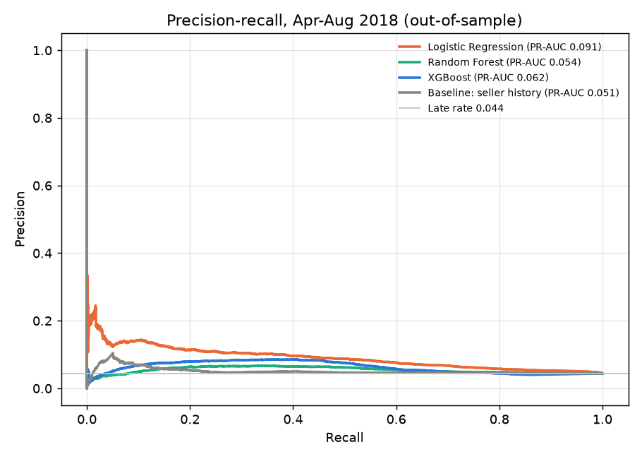
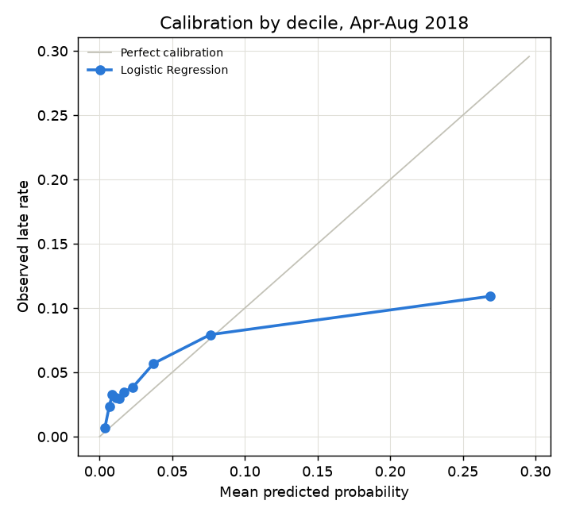
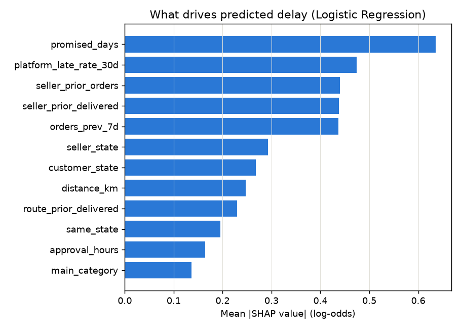

# Delivery-Delay Prediction

**Question:** when an order's payment is approved, how likely is it to arrive after the date the customer was promised?

## Set-up

- **Prediction moment: payment approval.** Features use only what is known then: the order, its items and payment, the promised date, distance, and history built from orders *delivered before this order was placed* (seller, route, platform-wide last 30 days, seller last 90 days). Carrier handover, transit and delivery timestamps are never features.
- **Monthly walk-forward backtest.** For each month, the model is trained only on orders whose outcome was known before the month began, calibrated on the most recent 45 days of that data, then scores every order placed in the month.
- **Jan-Mar 2018** (20,627 orders) select the model and fix decision thresholds. **Apr-Aug 2018** (32,150 orders) are the reported results.
- Why not one random or fixed split: late rates move from ~6% (2017) to ~15% (Feb-Mar 2018) to ~4% (mid-2018). A first attempt with one fixed split tuned the model on the worst quarter and tested it on a calm one; the walk-forward design and the recent-conditions features fix that.

## Results, Apr-Aug 2018 (out-of-sample)

| model                    |   ROC-AUC (monthly mean) |   PR-AUC (monthly mean) | PR-AUC monthly range   |   precision@top10% |   recall@top10% |   Brier (pooled) |
|:-------------------------|-------------------------:|------------------------:|:-----------------------|-------------------:|----------------:|-----------------:|
| Baseline: platform rate  |                    0.5   |                   0.044 | 0.012-0.066            |              0.055 |           0.111 |            0.043 |
| Baseline: seller history |                    0.524 |                   0.054 | 0.010-0.083            |              0.058 |           0.128 |            0.044 |
| Logistic Regression      |                    0.749 |                   0.132 | 0.047-0.186            |              0.147 |           0.342 |            0.046 |
| Random Forest            |                    0.611 |                   0.096 | 0.044-0.171            |              0.088 |           0.219 |            0.091 |
| XGBoost                  |                    0.633 |                   0.092 | 0.045-0.170            |              0.099 |           0.254 |            0.07  |

Selected model: **Logistic Regression** (highest PR-AUC on Jan-Mar 2018).

- Average monthly PR-AUC **0.132** against 0.054 for the seller-history baseline and 0.044 for a constant rate (a random score's PR-AUC equals the late rate); average monthly ROC-AUC **0.749**.
- Watching the riskiest 10% of each month's orders catches **34%** of late deliveries, and **15%** of watched orders are late: 3.4x the base rate.
- Pooled Brier score 0.0463 vs 0.0429 for the constant rate. Probabilities are re-levelled on the most recent 45 days, and when conditions change sharply between months (e.g. the end of the Feb-Mar 2018 spike) they lag behind. Treat them as relative risk; the ranking is the reliable part.
- Late delivery depends heavily on carrier events after payment, so this is a prioritisation tool (which orders to watch), not a yes/no oracle.

### Month by month (selected model)

|         |    n |   late_rate |   roc_auc |   pr_auc |   precision_top10 |   recall_top10 |
|:--------|-----:|------------:|----------:|---------:|------------------:|---------------:|
| 2018-04 | 6798 |       0.045 |     0.798 |    0.168 |             0.179 |          0.399 |
| 2018-05 | 6749 |       0.066 |     0.758 |    0.186 |             0.209 |          0.318 |
| 2018-06 | 6096 |       0.012 |     0.771 |    0.047 |             0.043 |          0.366 |
| 2018-07 | 6156 |       0.034 |     0.675 |    0.09  |             0.102 |          0.303 |
| 2018-08 | 6351 |       0.062 |     0.746 |    0.172 |             0.2   |          0.323 |

## Model selection, Jan-Mar 2018

| model                    |   ROC-AUC (monthly mean) |   PR-AUC (monthly mean) | PR-AUC monthly range   |   precision@top10% |   recall@top10% |   Brier (pooled) |
|:-------------------------|-------------------------:|------------------------:|:-----------------------|-------------------:|----------------:|-----------------:|
| Baseline: platform rate  |                    0.5   |                   0.129 | 0.057-0.190            |              0.124 |           0.083 |            0.118 |
| Baseline: seller history |                    0.55  |                   0.148 | 0.069-0.207            |              0.149 |           0.12  |            0.118 |
| Logistic Regression      |                    0.682 |                   0.242 | 0.111-0.312            |              0.292 |           0.229 |            0.131 |
| Random Forest            |                    0.64  |                   0.21  | 0.103-0.271            |              0.254 |           0.202 |            0.122 |
| XGBoost                  |                    0.665 |                   0.231 | 0.091-0.302            |              0.276 |           0.213 |            0.118 |

## Calibration (selected model, Apr-Aug 2018)

|    n |   mean_predicted |   observed_rate |
|-----:|-----------------:|----------------:|
| 3215 |           0.0036 |          0.0065 |
| 3215 |           0.0067 |          0.0236 |
| 3215 |           0.0088 |          0.033  |
| 3215 |           0.011  |          0.0305 |
| 3215 |           0.0135 |          0.0295 |
| 3215 |           0.0169 |          0.0348 |
| 3215 |           0.023  |          0.0386 |
| 3215 |           0.0372 |          0.0569 |
| 3215 |           0.0762 |          0.0793 |
| 3215 |           0.2688 |          0.1092 |

## Risk bands (calibrated probability, Apr-Aug 2018)

| risk_band   |     n |   observed_late_rate |
|:------------|------:|---------------------:|
| Low         | 28479 |               0.0364 |
| Medium      |  2445 |               0.0892 |
| High        |   871 |               0.132  |
| Critical    |   355 |               0.1465 |

## What drives the predictions (SHAP)

From the selected model (Logistic Regression) trained on data known before April 2018, explaining Apr-Aug orders. Categorical features sum the contributions of their one-hot columns:

| feature                |   mean_abs_shap |
|:-----------------------|----------------:|
| promised_days          |         0.63552 |
| platform_late_rate_30d |         0.47392 |
| seller_prior_orders    |         0.43951 |
| seller_prior_delivered |         0.43832 |
| orders_prev_7d         |         0.43656 |
| seller_state           |         0.29287 |
| customer_state         |         0.26807 |
| distance_km            |         0.24763 |
| route_prior_delivered  |         0.23005 |
| same_state             |         0.19494 |
| approval_hours         |         0.16423 |
| main_category          |         0.1362  |
| items_value            |         0.11102 |
| seller_late_rate_90d   |         0.08817 |
| seller_late_rate_hist  |         0.07997 |

Correlated features share credit: `seller_prior_orders` and `seller_prior_delivered` measure almost the same thing, so read them together rather than individually.

SHAP shows what the model relies on, not causal effects. A long promised window, for example, goes with fewer late orders because Olist sets longer promises for harder routes; lengthening a promise would not by itself make deliveries faster.

## Limitations

- Only delivered orders are labelled; orders still in transit at the data snapshot are excluded, slightly understating late rates at the very end of the period.
- Delivery outcomes are recorded per order; the largest seller represents multi-seller orders.
- Explanations come from the selected model as trained before April; each later month's model is refit on more data, so its weights drift slightly from the explained one.
